# GPUI UI Review — November 2026

A review of the GPUI frontend (`crates/ui_gpui`) for visual appeal, user
experience and understandability. It ends in a ranked list of improvement
proposals; each is scoped so one improvement run can take it on, with
evidence, a concrete proposal, acceptance criteria and the code to touch.

## How this was reviewed

- Read the render code (title bar, sidebar, composer, message blocks, tool
  cards, banners, settings, theme).
- Ran a debug build on Linux under Xvfb (software Vulkan) at 1440×900 and
  1024×680, against a scripted mock LLM that plays a realistic agent run
  (plan → list → run tests → search/read → edit → re-run tests → summary) on
  a small Python project. Tried dark and light themes, the right panel, the
  settings screen, the "Ask Before Writes" approval flow (allow, deny,
  stop).
- The harness is in [`scripts/ui-screenshots/`](../../scripts/ui-screenshots/run.sh),
  so improvement runs can take before/after screenshots in a cloud container.

Caveats: rendered on Linux, not macOS; fonts and the window chrome differ
there. Not covered: voice mode, browser panel, MCP/skills settings,
sub-agents panel, `ask_question` prompts, the terminal (TUI) frontend.

## What already works well (keep it)

- **Quiet inline tool lines.** Read/search/list collapse to one muted line
  with an icon; cards are reserved for commands and diffs. The transcript
  reads like a story, not a log.
- **Edit diffs are shown before approval** — exactly the right moment.
- **Sidebar status model.** "Working", "Needs approval" (orange, with icon),
  unread emphasis; colour is reserved for rows that need the user.
- **Plan banner** gives a clear sense of progress during a run.
- **Craft details:** the spring-animated segmented switches, the 14×14
  icon/spinner slot that avoids layout shift, the WCAG test for syntax
  colours on diff rows (`shared/theme.rs`), the composer's selector row
  collapsing behind "⋯" instead of overflowing.

## Ranked improvement proposals

Ranked by (user impact × how often it is hit) relative to effort. Effort:
S ≈ a focused run, M ≈ one or two runs, L ≈ several.

| # | Proposal | Area | Impact | Effort |
|---|----------|------|--------|--------|
| 1 | [Stop hard-coding "Menlo": monospace text is broken on Linux/Windows](#1-stop-hard-coding-menlo) | Typography | Critical (non-macOS) | S |
| 2 | [Make approval prompts say what is approved, next to the card](#2-approval-prompts-that-say-what-is-approved) | Trust / safety | High | M |
| 3 | [Show denied/stopped/failed outcomes in the user's language](#3-outcomes-in-the-users-language) | Transcript | High | S–M |
| 4 | [One clear primary action in the composer; focus and empty-session behaviour](#4-composer-one-primary-action) | Composer | High | S |
| 5 | [Turn "Sandbox" + "Permissions" into one understandable autonomy control](#5-one-understandable-autonomy-control) | Understandability | High | M |
| 6 | [Platform-aware, lean title bar with context](#6-platform-aware-lean-title-bar) | Chrome | Medium–High | M |
| 7 | [Keyboard shortcuts and session search](#7-keyboard-shortcuts-and-session-search) | Efficiency | Medium–High | M |
| 8 | [Empty states that guide: no session, new session, no projects](#8-empty-states-that-guide) | Onboarding | Medium | S |
| 9 | [Stop floating buttons from covering the transcript](#9-floating-buttons-cover-the-transcript) | Layout | Medium | S |
| 10 | [Budget the vertical space of the footer stack](#10-budget-the-footer-stack) | Layout | Medium | M |
| 11 | [Design tokens: colours, type scale, icon buttons, contrast](#11-design-tokens-colours-type-scale-icon-buttons-contrast) | Visual system | Medium (compounding) | L |
| 12 | [Human-readable tool labels and command status](#12-human-readable-tool-labels-and-command-status) | Transcript | Medium | S |
| 13 | [Markdown and message styling polish](#13-markdown-and-message-styling-polish) | Visual | Medium | S–M |
| 14 | [Sidebar polish: destructive actions, contrast, titles](#14-sidebar-polish) | Sidebar | Medium | S |
| 15 | [Settings consistency](#15-settings-consistency) | Settings | Low–Medium | S |
| 16 | [Composer selector row: priorities when narrow, unambiguous context meter](#16-composer-selector-row-when-narrow) | Composer | Low–Medium | S |
| 17 | [Diff card header and gutter](#17-diff-card-header-and-gutter) | Tool cards | Low–Medium | S |
| 18 | [Right panel discoverability](#18-right-panel-discoverability) | Right panel | Low | S |
| 19 | [Re-check the global Escape → cancel agent binding](#19-global-escape-cancels-the-agent) | Safety | Low (verify) | S |

---

### 1. Stop hard-coding "Menlo"

**Problem.** Every monospace surface asks for `"Menlo"`, a font that only
ships with macOS: the live terminal (`TerminalView::new(.., "Menlo", ..)`),
terminal card bodies, diff rows, inline tool output, code in the file viewer
and review view. On Linux and Windows — both offered as downloads in the
README — the text system falls back to a proportional font. The live terminal
lays that font out on a fixed cell grid, which makes test output unreadable;
diffs and finished terminal output lose their column alignment. (A fontconfig
alias does not help: gpui's Linux text stack matches family names itself.)

**Evidence.** 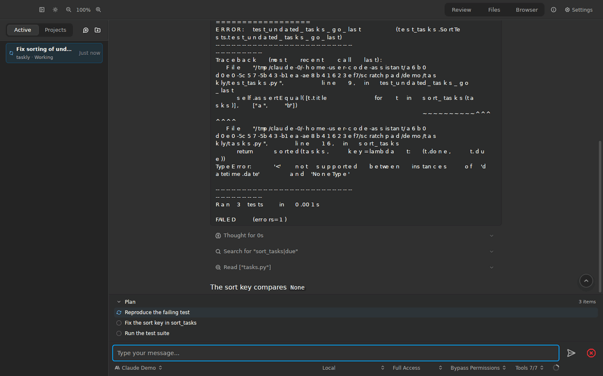

**Proposal.**
- One theme-level `mono_font_family` (or a small `fonts` module) with a
  per-platform default and fallback chain: Menlo/SF Mono on macOS, Cascadia
  Mono/Consolas on Windows, DejaVu Sans Mono/Liberation Mono/Noto Sans Mono
  on Linux — or bundle one open monospace font with the app (the app already
  embeds assets via `rust-embed`).
- Replace all literal `"Menlo"` call sites with it.
- Optional: a *Settings → Appearance* field for the code font and size.

**Acceptance.** `rg '"Menlo"' crates/ui_gpui crates/terminal_view` finds
nothing outside the font module; on Linux the terminal card and diff card
render on an aligned grid (screenshot via the harness).

**Where.** `tool_cards/terminal_card.rs:73,737,807`, `tool_cards/diff_card.rs:323`,
`tool_cards/inline_renderer.rs:192`, `tool_cards/browser_renderer.rs:81`,
`blocks/render.rs:1042`, `input/comments.rs:255`,
`main_screen/right_panel/{file_viewer.rs:855,review_view.rs:1199}`; also the
`"monospace"` uses in `about_dialog.rs` and `general_section.rs`.

---

### 2. Approval prompts that say what is approved

**Problem.** With "Ask Before Writes" the prompt reads *"Permission required:
execute_command — Run tool \`execute_command\`"*: the internal tool name, the
backticks shown literally, and not the command. For an edit it says *"Run tool
\`edit\`"* without the file. The summary is cut to one line with an ellipsis,
so a long command could not be read in full anyway. The prompt sits at the
bottom of the window, separated from the card it belongs to by the plan
banner; meanwhile the composer keeps the bright focus ring, so the eye goes
to the text field rather than the decision. The card itself shows no
"waiting for you" state, and there are no keyboard shortcuts.

**Evidence.** 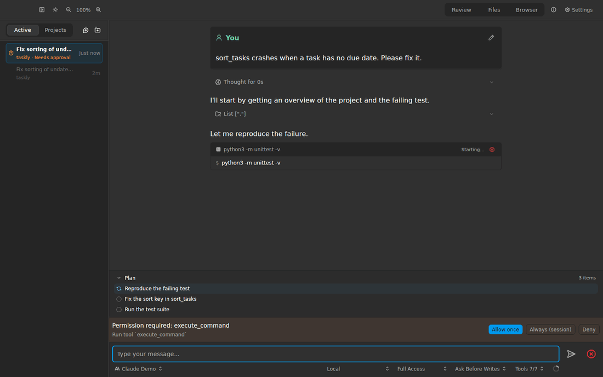

**Proposal.**
- Build the summary from what the tool does: "Run `python3 -m unittest -v`
  in taskly", "Edit tasks.py (+4 −1)", "Delete 3 files". The
  `ExecuteCommand` reason already formats this, but tier-gated tools go
  through the generic `ToolInvocation` branch. Reuse the renderers'
  `describe()` or add a `describe_for_permission` to the tool spec.
- Render the summary as Markdown/inline code, never truncate it (wrap, cap
  height, scroll), and show the full command/path list.
- Mark the waiting card ("Awaiting approval" chip, accent border) and either
  put the buttons in the card or scroll the card into view when the prompt
  appears.
- Move focus to the prompt; keyboard: ⏎ allow once, ⌘/Ctrl-⏎ always for this
  session, a dedicated deny key. Rename "Always (session)" to "Allow for this
  session".

**Acceptance.** For `execute_command`, `edit`, `write_file`,
`delete_files` the prompt names the command or path(s); no literal backticks;
the pending card is visually distinct; approval works from the keyboard.

**Where.** `code_assistant_core/src/session/permissions.rs:195` (`request_data`),
`ui_gpui/src/main_screen/mod.rs:1404` (`render_permission_prompts`),
`tool_cards/*` for the pending state.

---

### 3. Outcomes in the user's language

**Problem.** After *Deny*, the edit card still shows the full red/green diff
— it reads as applied — followed by the message written for the model, in
alarming red: *"Tool execution has not started. Error in tool request: The
user denied permission to run tool 'edit'. Do not simply retry; ask the user
how to proceed…"*. After *Stop*, the pending command card says *"Tool
execution has not started. Error in tool request: run cancelled"*, the plan
item keeps spinning although nothing runs, and nothing in the transcript says
the user stopped the run.

**Evidence.** 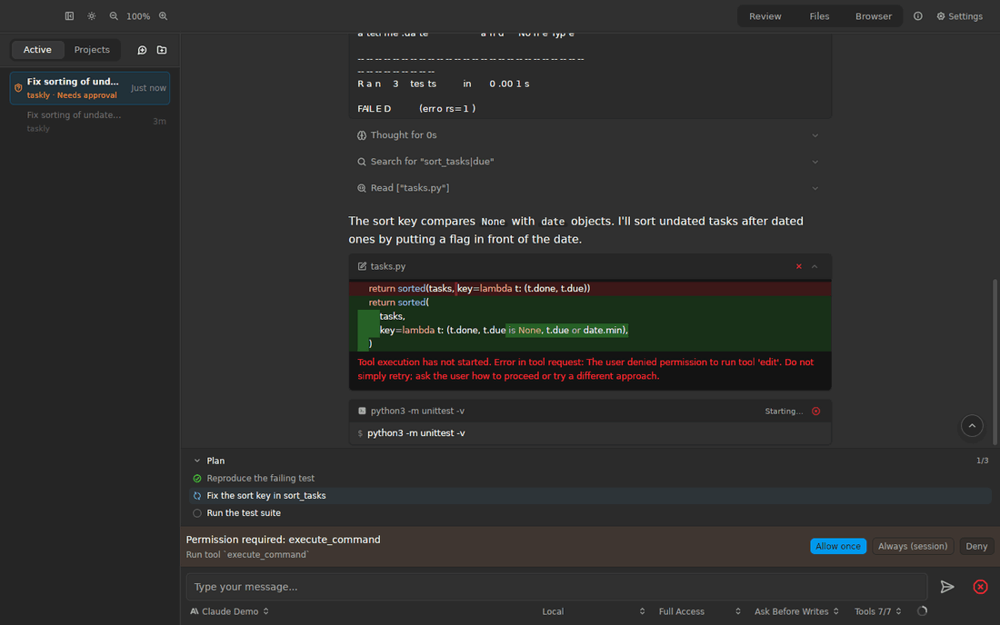 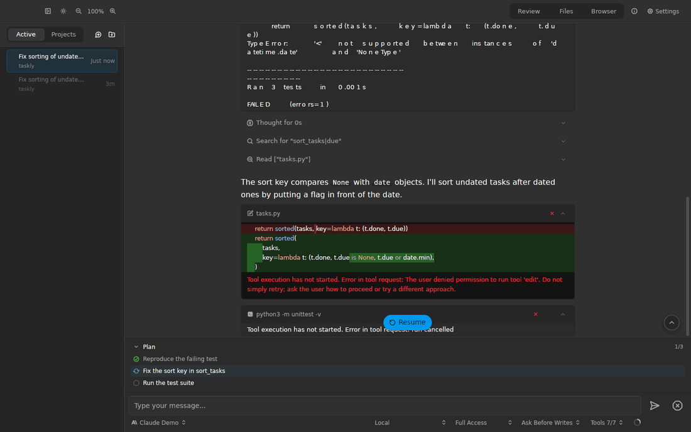

**Proposal.**
- Give tool results a user-facing status separate from the model-facing
  text: *Denied by you*, *Stopped*, *Failed: <short reason>*. Show it as a
  muted chip in the card header; keep the model text behind a "Details"
  disclosure.
- Denied/stopped edits: collapse or dim the diff and label it "Not applied".
- When a run ends (stop, error, deny), show in-progress plan entries as
  paused (no spinner) and add a small "Stopped by you · Resume" marker at the
  end of the transcript.

**Acceptance.** Neither the deny nor the stop path shows text addressed to
the model by default; a denied diff cannot be mistaken for an applied one;
no spinner remains anywhere once the session is idle.

**Where.** `agent_core/src/execution.rs:38` (message source),
`ui_gpui/src/blocks/render.rs` (status/description), `tool_cards/diff_card.rs`,
`tool_cards/terminal_card.rs`, `shared/plan_banner.rs`.

---

### 4. Composer: one primary action

**Problem.**
- Send and Stop are two 40px ghost icons side by side, always visible. When
  idle, the stop icon stays (grey) and is the most prominent shape on the
  right; while running, a red stop sits next to a send button.
- Neither has a tooltip or shortcut hint (Enter sends, Esc stops,
  Shift-Enter breaks the line — nowhere to be learned).
- With no session, the composer and all selectors look fully enabled
  ("Select Model", "Full Access"…) — typing there has no obvious target.
- Creating a session does not focus the text field.

**Evidence.** 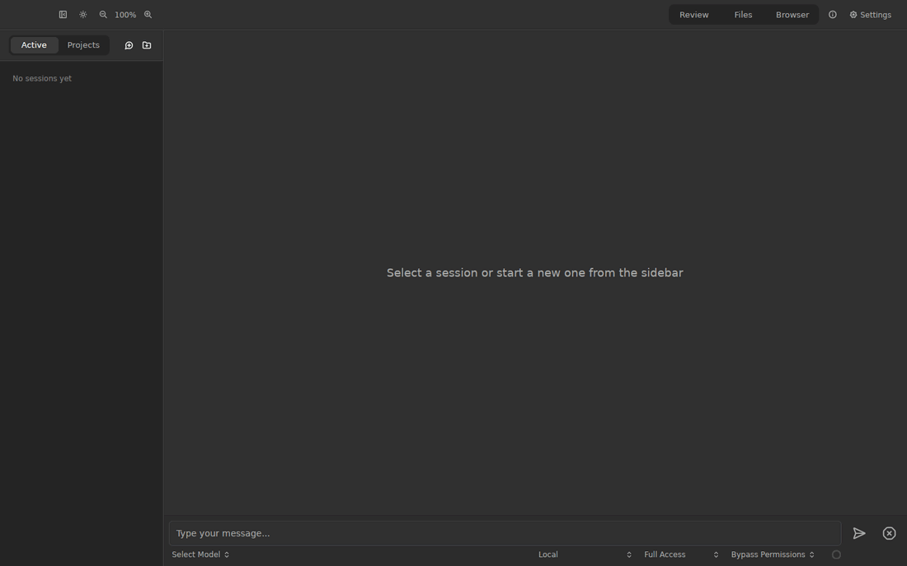 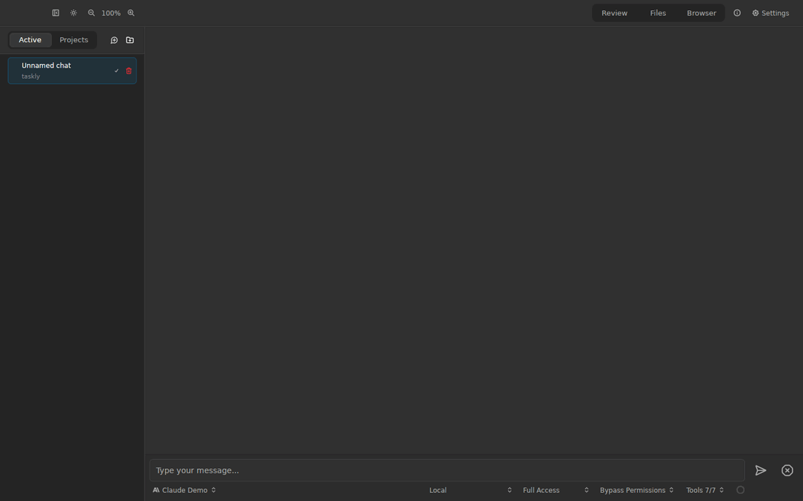

**Proposal.** One filled primary button that morphs Send ↔ Stop (Stop only
while a run is cancellable), with tooltips "Send (⏎)" / "Stop (Esc)". A
short hint in the placeholder ("Ask anything · ⏎ to send, ⇧⏎ for a new
line"). With no session, either hide the composer or make the first message
start a session in the last-used project (with the project shown as a chip).
Focus the field when a session is created or selected.

**Acceptance.** Exactly one action button visible at any time; tooltips on
both states; the field has focus after "New session".

**Where.** `input/mod.rs:980` (`render_input_area`), `main_screen/mod.rs`
(`handle_session_change`, new-session handling).

---

### 5. One understandable autonomy control

**Problem.** Two adjacent selectors govern safety: *Sandbox* ("Full Access",
"Read Only", "Workspace Write") and *Permissions* ("Bypass Permissions",
"Ask Before Outward Actions", "Ask Before Writes", "Ask For All Tools"). Both
default to the most permissive value, both are drawn in the same muted grey
as the model picker, the options have no descriptions, the menu truncates its
own option ("Ask Before Outw…"), and with the right panel open both disappear
behind "⋯". Users must understand two orthogonal concepts to answer "how much
may the agent do on its own?".

**Evidence.** 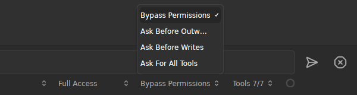 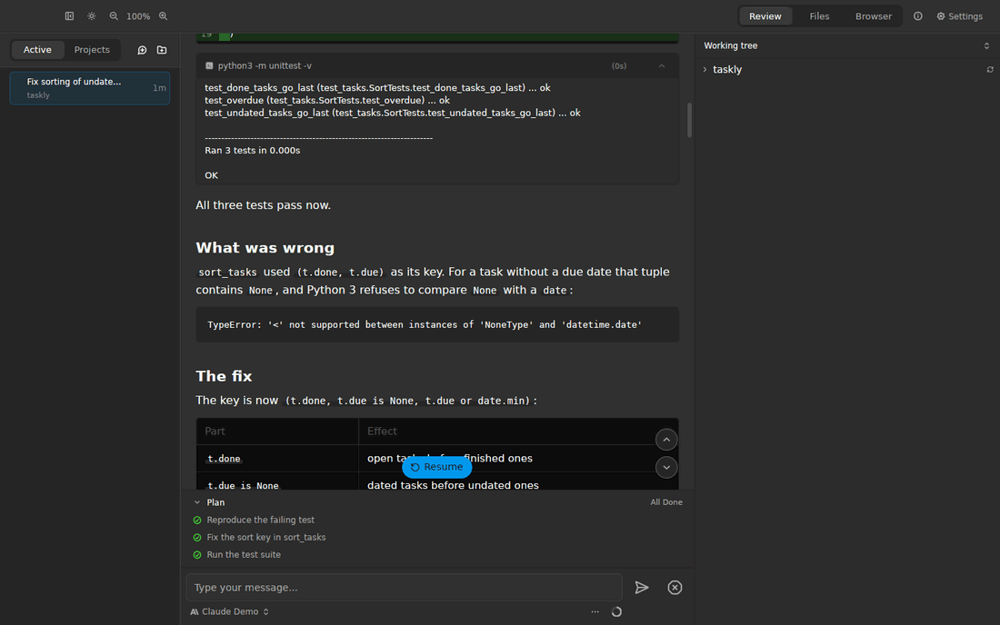

**Proposal.** One "Autonomy" control with 3–4 presets that combine both
settings (e.g. *Read only*, *Ask before changes*, *Auto in workspace*, *Full
access*), each with a one-line description in the menu; an "Advanced" entry
opens the two raw settings. Show permissive presets with a warning tint/icon;
never collapse this control behind "⋯" (collapse worktree/MCP first).

**Acceptance.** Menu options are not truncated and each has a description;
the current autonomy level is visible at every window width; a permissive
setting is visually distinguishable from a safe one.

**Where.** `input/sandbox_selector.rs`, `input/permission_selector.rs`,
`input/selector_row.rs`, `docs/permission-tiers.md`.

---

### 6. Platform-aware, lean title bar

**Problem.**
- The custom 48px title bar always reserves 86px on the left "for macOS
  traffic lights". On Linux/Windows the window keeps its native title bar
  (`appears_transparent: false`), so users get two title bars and an empty
  gutter.
- Prime space goes to developer-ish controls — theme toggle, zoom −, 100%,
  zoom + — none with a tooltip. General settings even says *"Theme and zoom
  controls are available in the titlebar."*
- The bar shows nothing about where the user is: no session title, project
  or branch.
- The macOS app menu is named **"GPUI App"**, the Window menu is empty, and
  there are no View/Session menus.

**Evidence.** 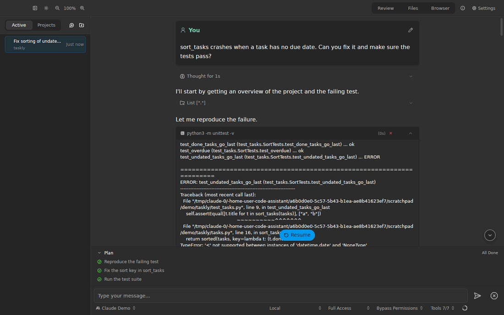

**Proposal.** Apply the traffic-light padding only on macOS (or draw custom
window controls with client-side decorations on Linux/Windows). Move theme
and zoom to *Settings → Appearance* plus a View menu with shortcuts; put the
session title, project and branch in the middle of the bar. Name the app
menu "Code Assistant" and add Settings…, New Session, Toggle Sidebar,
Zoom In/Out/Reset. Every remaining icon button gets a tooltip.

**Acceptance.** No empty left gutter off macOS; the title bar shows the
current session's title and project; app menu is named correctly.

**Where.** `main_screen/mod.rs:1940–2135`, `settings_screen/mod.rs` (same
86px), `lib.rs:373` (`init`, menus), `lib.rs:845` (window options).

---

### 7. Keyboard shortcuts and session search

**Problem.** The only bindings are Cmd-Q, Esc (cancel agent) and line
breaks; `cmd-` bindings do not translate to Ctrl on Linux/Windows. There is
no shortcut for new session, settings, toggling the sidebar/right panel,
switching sessions or zoom, and no way to search sessions in the sidebar —
it will not scale beyond a few dozen sessions.

**Proposal.** Use gpui's platform-neutral `secondary-` modifier and add:
New session (⌘N), Settings (⌘,), Toggle sidebar (⌘B), Toggle right panel
(⌘⌥B or ⌘J), Session switcher with fuzzy search (⌘K or ⌘P, reusing the
project picker's popover), Zoom (⌘+ / ⌘− / ⌘0), Focus composer (⌘L). Show
the shortcut in each tooltip and menu item.

**Acceptance.** All listed actions work by keyboard on macOS and Linux; a
session can be found by typing part of its title.

**Where.** `lib.rs:373` (`init`), `sidebar/mod.rs`, `sidebar/project_picker.rs`.

---

### 8. Empty states that guide

**Problem.** No session: one grey sentence ("Select a session or start a new
one from the sidebar") in the middle of an otherwise empty, enabled-looking
screen. New session: a completely blank canvas — no project, branch, model
or hint of what to ask. Sidebar: "No sessions yet" in 12px grey without an
action.

**Evidence.**  

**Proposal.** No session: a centred card with a primary "New session"
button (and shortcut), the most recent sessions, and "Add project" when
none exist. New session: a header naming project, branch/worktree and model,
plus 3–4 starter prompts ("Explain this codebase", "Find and fix failing
tests", "Review my uncommitted changes"). Sidebar empty state with a button.

**Acceptance.** Each of the three empty states offers at least one clickable
next step.

**Where.** `messages/mod.rs:966`, `sidebar/mod.rs:530` (`render_inbox`).

---

### 9. Floating buttons cover the transcript

**Problem.** The "Resume" pill is centred over the bottom of the transcript
and stays there: it covers text, table rows and card headers. Up to two
round scroll buttons sit next to it on the right and also cover card
chevrons in narrower windows.

**Evidence.** 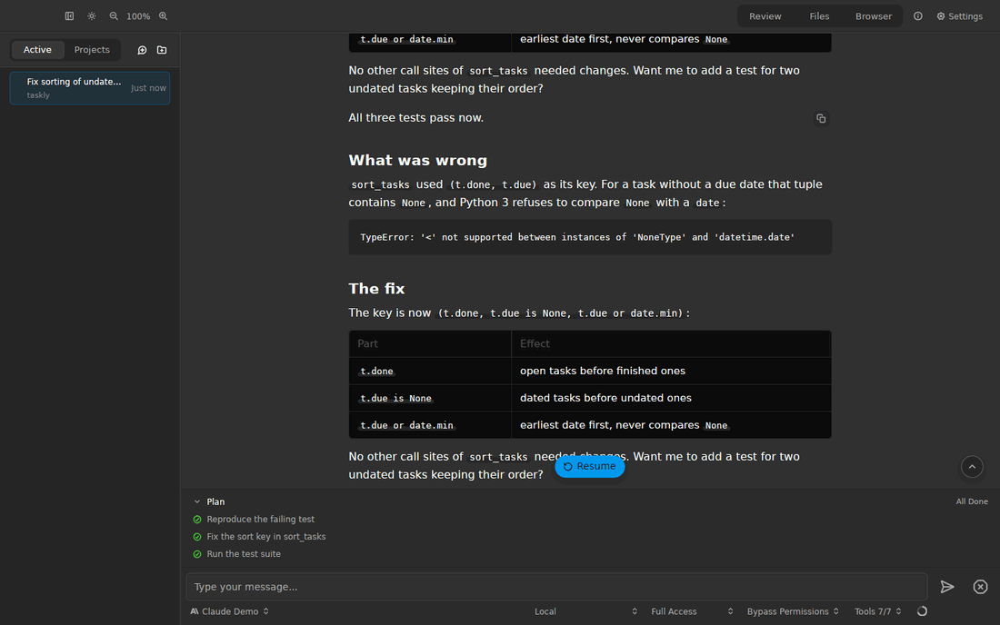 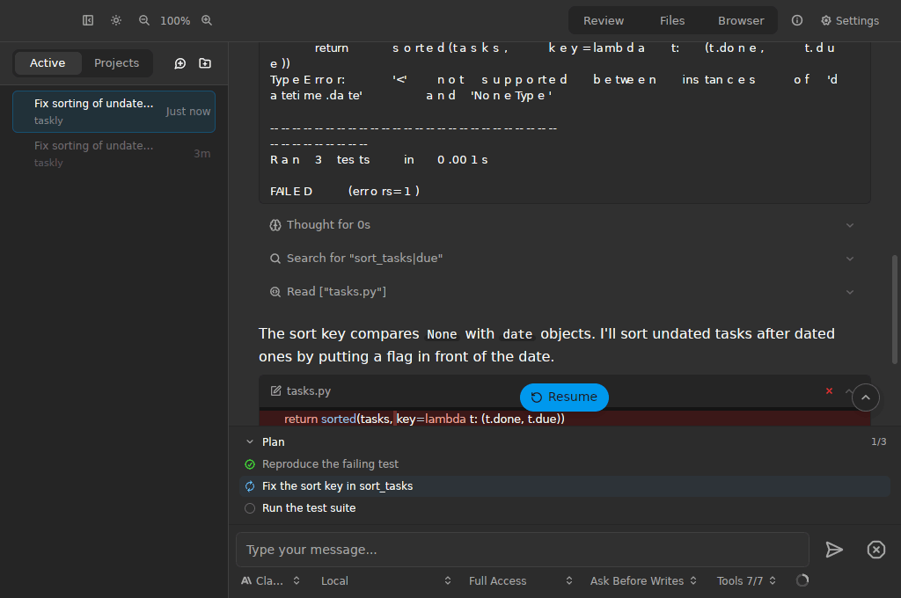

**Proposal.** Show "Resume" as an inline row at the end of the transcript
("This run was interrupted · Resume") or as a strip above the composer —
never over content. One scroll button ("Jump to latest") that appears only
when scrolled away from the bottom; drop the "scroll to top" button or move
it to a shortcut.

**Acceptance.** No floating element overlaps message content at the bottom
of the transcript at any window size.

**Where.** `messages/mod.rs:1128` (resume button) and the scroll buttons there.

---

### 10. Budget the footer stack

**Problem.** Between transcript and composer there can be: plan banner
(≈110px, stays expanded after "All Done"), permission prompts, question
prompt, new-context prompt, agents panel, edit/sub-agent/locked banners,
attachments, the text field and the selector row. At 1024×680 the
conversation keeps ~430px; with an approval prompt it is less.

**Evidence.** 

**Proposal.** Collapse the plan to a one-line progress chip ("Plan 3/3 ✓")
when done or when the window is short; expand on click. Cap the footer stack
at e.g. 40% of the window and let it scroll. Unify the strips' styling so
they read as one "status tray" instead of separate bands with different
backgrounds.

**Acceptance.** At 1024×680 with a finished plan, the transcript keeps at
least 60% of the window height.

**Where.** `main_screen/mod.rs:2180–2205`, `shared/plan_banner.rs`,
`main_screen/agents_panel.rs`.

---

### 11. Design tokens: colours, type scale, icon buttons, contrast

**Problem.** The visual system is held together by convention rather than
tokens, which makes every change above harder and lets drift accumulate:
- 73 hard-coded `rgb/rgba/hsla` colours in 17 files outside the theme (user
  accent green, "violet", error popover reds, tool card header greys,
  segmented-switch track…).
- Ad-hoc text sizes: `rems(0.6875 | 0.75 | 0.78125 | 0.8125 | 0.875 | 1.0 |
  1.125)`, `px(10/11)`, plus 166 `text_xs()` — much of the UI is 11–12px.
- Icon buttons are hand-rolled `div`s repeated in the title bar, composer,
  messages and settings (`Done`), most without tooltips, focus rings or
  disabled styling; gpui-component's `Button` is used only in some places.
- Theme issues: dark `primary_hover` jumps hue (#0099EE → #4466CC); light
  `primary` #53AEFF with white text has 2.4:1 contrast (Resume pill);
  light muted text on the sidebar 3.7:1, sidebar hints at 70% opacity 2.3:1;
  chevrons at 40% opacity ≈2.1:1.

**Evidence.** 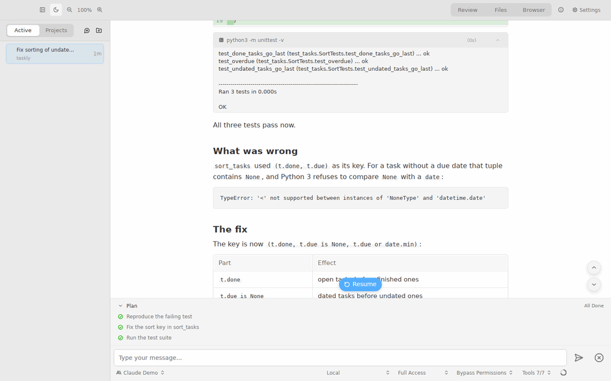

**Proposal.**
- Add semantic tokens (e.g. `user_accent`, `merged`, `error_surface`,
  `card_header`, `diff_*`) in `shared/theme.rs` and replace literals.
- Define a 5-step type scale (caption 11, small 12, body 13–14, title 15–16,
  heading) and map existing sizes onto it.
- One `IconButton` helper with required tooltip, hover/active/focus/disabled
  states; replace hand-rolled ones.
- Fix the primary colours (hover = same hue, darker; light primary dark
  enough for white text ≥4.5:1) and extend the existing WCAG test in
  `theme.rs` to UI token pairs (text on surfaces, primary foreground on
  primary).

**Acceptance.** No colour literals outside `theme.rs` (lint by `rg`); the
contrast test covers foreground/muted/primary pairs in both modes and
passes at ≥4.5:1 (≥3:1 for large/non-text).

**Where.** `shared/theme.rs`, then the 17 files listed by
`rg -l 'rgb\(0x|rgba\(0x|hsla\(' crates/ui_gpui/src`.

---

### 12. Human-readable tool labels and command status

**Problem.** Inline tool lines print parameters as raw JSON: `List ["."]`,
`Read ["tasks.py"]`. The terminal card header shows only "(0s)" and, on
failure, a tiny red "×" that looks like a close button; success shows
nothing, so the exit status is not readable at a glance. Generic fallbacks
replace `_` with spaces (`tool.name.replace('_', " ")`).

**Evidence.** 

**Proposal.** Format path lists ("Read tasks.py", "Read 3 files: a.rs,
b.rs +1", "List project root"). In the terminal header show an exit chip
("exit 1" in danger colour, "✓" or "exit 0" muted) and the duration ("0.4s"
instead of "(0s)"). Give MCP and unknown tools a title-cased label from the
tool spec.

**Acceptance.** No `[` or `"` from JSON appear in tool labels for the
built-in tools; the exit status of every finished command is visible in its
header.

**Where.** `tool_cards/inline_renderer.rs` (templates, `resolve_template`),
`tool_cards/terminal_card.rs:310–400` (header).

---

### 13. Markdown and message styling polish

**Problem.**
- Tables: the header row is dimmer than the body (inverted hierarchy) and
  the table background is near-black against the #303030 message surface —
  the heaviest element on screen.
- Inline code backgrounds sit visibly below the glyphs (seen on Linux;
  verify on macOS once #1 is fixed).
- User messages are a card with a full header row ("👤 You" in an
  off-palette green plus an edit pencil) — heavy for every turn.
- Headings are large and bold relative to 15px body text.

**Evidence.** 

**Proposal.** Table header in foreground/semibold on a subtle tint, body on
the surface colour with hairline row borders. Centre inline-code pills on the
text's ascent/descent. User message: drop the header row, keep a tinted
bubble/card, show edit on hover. Tone headings down one step.

**Where.** `blocks/render.rs`, `messages/message_item.rs`, markdown styles
used by `TextView`.

---

### 14. Sidebar polish

**Problem.** The selected row always shows a red trash icon next to the
settle check — destructive and colourful at rest. Read sessions recede so far
that they are hard to read (≈3.7:1 light, lower for hints). Two sessions with
the same truncated title ("Fix sorting of undate…") are indistinguishable.
New sessions are called "Unnamed chat" until the model names them.

**Evidence.**  

**Proposal.** Show settle/delete on hover only, delete in muted colour with
confirm or undo toast; consider a context menu (rename, settle, delete, copy
path). Raise contrast of read rows. On duplicate titles, show a
distinguishing detail (time or first words of the prompt). Use the first
words of the first prompt as the provisional title.

**Where.** `sidebar/session_item.rs`, `sidebar/mod.rs`.

---

### 15. Settings consistency

**Problem.** *General* is left-aligned while *Providers*/*Models* are centred
columns; General's file paths overflow its own content width; number inputs
have no visible border. The screen opens on *Providers* although *General*
is first. *Done* is the only way back (Esc does nothing). The *Providers*
nav icon is the Anthropic logo.

**Evidence.** 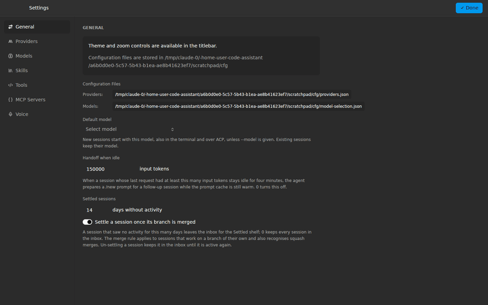

**Proposal.** One content column (max-width ~720px, same alignment) for
every section; paths as truncating text with a copy/open button; consistent
input styling; Esc closes; remember the last section; a neutral icon for
Providers; add an *Appearance* section (theme, zoom, fonts — see #1, #6).

**Where.** `settings_screen/mod.rs`, `settings_screen/general_section.rs`.

---

### 16. Composer selector row when narrow

**Problem.** Selectors have a fixed `min_w(130px)`, so in a 1024px window the
model name truncates to "Cla…" while "Local" (worktree) keeps ~150px of
mostly empty space. The context ring with partial fill looks like a loading
spinner.

**Evidence.** 

**Proposal.** Size selectors to their content, shrink the least important
first (worktree, MCP/tools), keep the model name readable. Draw context as a
labelled meter ("12%") or a ring with a track and a percentage on hover; use
the warning colour from 80%.

**Where.** `input/selector_row.rs`, `input/*_selector.rs`,
`shared/context_indicator.rs`.

---

### 17. Diff card header and gutter

**Problem.** The header shows only the file name — no +/− counts, no path
for files outside the root. Removed lines have no line number while added
lines do. Added blocks use a heavily saturated green that dominates the
screen.

**Evidence.** 

**Proposal.** Header: relative path, "+4 −1", open-in-Files action. Gutter:
old and new line numbers (or one column showing the old number on removed
lines). Reduce the saturation of row backgrounds; keep word-level emphasis
for the changed parts (the existing contrast test still applies).

**Where.** `tool_cards/diff_card.rs`, `tool_cards/diff_rows.rs`.

---

### 18. Right panel discoverability

**Problem.** *Review* opens on a collapsed project node with no hint of how
many files changed until expanded. *Files* shows a bare ".gitignore" label at
the top right whose meaning (a toggle?) is unclear.

**Evidence.** 

**Proposal.** Show the change count on the project row and expand it when
there are few changes; a badge with the count on the *Review* segment of the
title-bar switch. Replace the ".gitignore" label with a clearly labelled
toggle ("Show ignored files").

**Where.** `main_screen/right_panel/review_view.rs`,
`main_screen/right_panel/files_view.rs`.

---

### 19. Global Escape cancels the agent

**Problem.** `escape` is bound globally to `CancelAgent` (`lib.rs:384`).
Escape is the universal "close this popup" key; if any popover or dialog
does not consume it, the user stops a long run while meaning to close a
menu. Not reproduced in this review — needs a check of every popover.

**Proposal.** Scope the binding to the composer/messages context, or require
a second Escape within a short time ("Press Esc again to stop"), and show
the shortcut on the Stop button.

**Where.** `lib.rs:373`, `main_screen/mod.rs` (`on_cancel_agent`).

---

## Suggested sequencing for improvement runs

1. **#1 fonts** — small, unblocks fair visual review on Linux/Windows.
2. **#2 + #3** together — the approval/outcome story is one flow.
3. **#4, #8, #9** — composer, empty states and overlays (all small, very
   visible).
4. **#11 tokens** before larger visual polish (**#13, #14, #17**), so that
   polish lands on tokens instead of new literals.
5. **#5, #6, #7, #10** — larger interaction changes; agree on the design
   first (a mock-up per item).

Each run can verify with `scripts/ui-screenshots/run.sh` and compare against
the screenshots in this folder.
